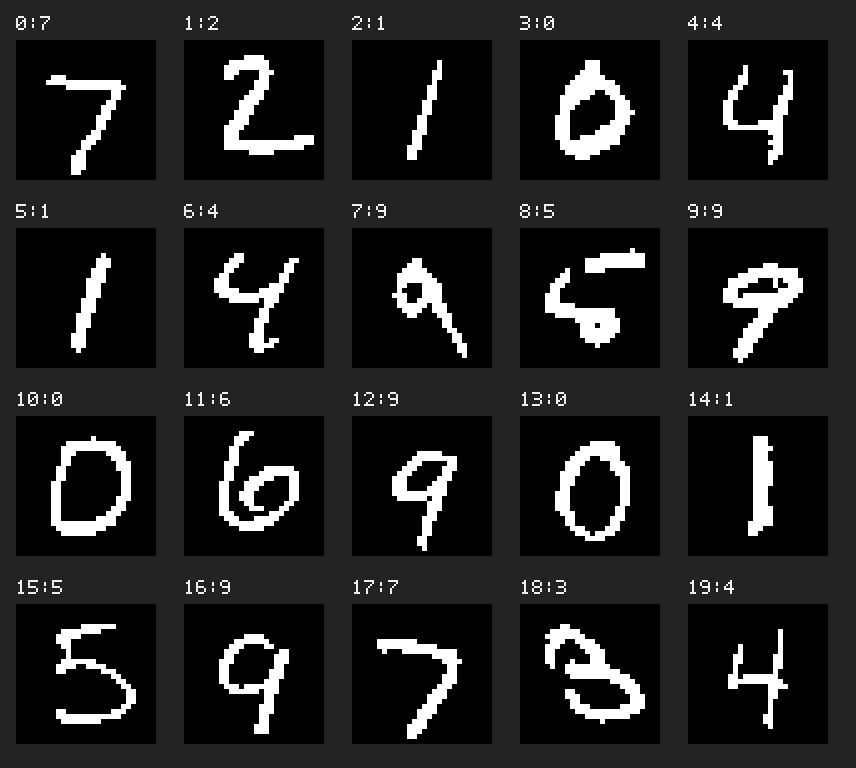

# MNIST CNN on C6416 with Linear Assembly（HUST结课作业）

在 **TMS320C6416 / C64x DSP** 上运行手写数字识别 CNN，并使用 TI 线性汇编加速第二层卷积中的点积计算。项目用于HUST电信专硕《嵌入式系统设计与实验》结课实验，已完成真实开发板运行和课程验收。

本仓库基于 [ih8gin/Mnist-on-dsp-chip](https://github.com/ih8gin/Mnist-on-dsp-chip) 修改。网络结构、训练好的权重和原始 MNIST 测试数据来自原项目；本次工作主要是裸机推理整理、线性汇编内核优化、CCS 3.1 工程适配及公平的断点计时。没有重新训练模型。

## 环境

- 硬件：TI DSK6416，TMS320C6416 / C64x。
- 软件：Windows XP、Code Composer Studio 3.1、课程配套 TI C6000 编译工具链。
- 工程：传统 `.pjt`，`-mv6400`，COFF ABI，裸机运行，不使用 DSP/BIOS 或其他操作系统。
- 调试：电脑通过 USB 连接板载 JTAG 仿真器，在 CCS 中加载、运行和设置断点。

DSP 端不需要 Python、TensorFlow、图片解码库或运行时文件系统。权重及默认 20 张测试图像已编入 `conv/cnn_data.h`。

## 网络结构

| 层 | 运算 | 输出尺寸 |
|---|---|---|
| 输入 | 28×28 二值图像，像素为 0/1 | 28×28×1 |
| 卷积 1 | 5×5，1→5 通道，ReLU | 24×24×5 |
| 池化 1 | 2×2 最大池化 | 12×12×5 |
| 卷积 2 | 5×5，5→10 通道，ReLU | 8×8×10 |
| 池化 2 | 2×2 最大池化 | 4×4×10 |
| 分类头 | 全局平均池化、1×1 卷积，10→10 | 10 个分数 |
| 输出 | argmax | 数字 0～9 |

模型共有 1,500 个参数。推理保持原项目的整数运算方式，包括平均池化中的整数截断。

## 加速的位置

第二层卷积的每个窗口包含 `5×5×5 = 125` 项数据。程序将窗口和权重整理成连续的 `short` 数组，补 3 个零到 128 项，再调用所选点积内核：

```c
/* 普通 C：计算相同的 128 项 */
cnn_dotprod128_c(x, w);

/* TI C64x 线性汇编：实际链接 cnn_dotprod128.sa */
cnn_dotprod128(x, w);
```

`.sa` 使用 `LDDW` 加载、`DOTP2` 有符号双 16 位点积和两个独立累加器，循环 32 次，每次处理 4 项。TI Assembly Optimizer 负责寄存器分配与软件流水调度。两版使用相同数据布局和计算量；C 函数也提供真实的对齐信息，没有通过降低 C 版本优化级别来制造加速。

输入需满足源码规定的对齐与数值范围：`x % 32 == 0`、`w % 32 == 16`，且所有乘积绝对值之和不超过 `INT_MAX`。生产代码在初始化和数据整理时检查相关条件。

## 编译和上板

1. 将仓库复制到 XP 虚拟机中的英文路径，例如 `C:\mnist_c6416`。
2. 在 CCS 3.1 中打开 `conv\dsp.pjt`，选择课程使用的 DSK6416 调试配置并连接板卡。
3. 如果 CCS 安装位置不同，将工程中的 include 路径和 `rts6400.lib` 路径改为实际的 C6000 `cgtools` 目录。工程默认路径是 `C:\CCStudio_v3.1\C6000\cgtools`。
4. 在 `conv/cnn_config.h` 中选择实现，默认启用汇编：

   ```c
   #define USE_LINEAR_ASM 1  /* 0 = C，1 = 线性汇编 */
   ```

5. 选择 **Debug**，执行 **Project → Rebuild All**。
6. 通过 **Load Program** 加载本次生成的 `conv\Debug\cnn_linear.out`，执行 **Go Main** 后 Run。

Release 配置输出到 `conv\Release\cnn_linear.out`。两次比较必须使用相同配置；下面记录的实测结果来自 Debug，不应与 Release 混比。

若旧 CCS 将链接器参数拼接成错误路径，在 Linker 设置中分别检查 Map Filename 和 Output Filename，Debug 对应：

```text
.\Debug\cnn_linear.map
.\Debug\cnn_linear.out
```

`conv/build_ccs3.bat` 提供命令行构建方式，输出在 `conv/build/`，使用 `-o3`；该方式不等同于下面的 Debug 实测配置。

## 用 CCS Clock 比较 C 和汇编

打开 `conv/clock_demo.c`，找到 `cnn_clock_demo()`：

```c
#if USE_LINEAR_ASM
    g_clock_result = cnn_dotprod128(x, w);   /* CLOCK_START_ASM */
#else
    g_clock_result = cnn_dotprod128_c(x, w); /* CLOCK_START_C */
#endif
    g_clock_done = 1;                       /* CLOCK_STOP */
```

1. 在当前启用的 `CLOCK_START_*` 调用行设置第一个断点，在 `CLOCK_STOP` 行设置第二个断点。
2. 打开 **Profile → Clock → View** 并启用 Clock。
3. Run 到第一个断点。此时调用还未执行，将 Clock 清零。
4. 用 Run 继续到第二个断点，记录 Clock cycles。测量区间内不单步、不打印、不保留内核内部断点。
5. 将唯一宏从 1 改为 0，或从 0 改为 1；保持同一 Debug 配置，**Rebuild All，重新 Load Program**，重复测量。
6. 优化后源码行与机器指令不一定一一对应，应在 Disassembly 中确认起点在调用之前、终点在调用返回和结果保存之后。可通过函数符号 `_cnn_dotprod128` 及其 `LDDW`、`DOTP2` 指令确认进入了汇编内核。

程序先完成 20 张图的推理，然后使用保存的首张图真实卷积窗口做一次独立点积测量。因此到第一个断点时，Console 已出现 20 张图的结果是正常现象。待测点积仍会在两个断点之间重新计算；预热在计时之前，C 对照核对在计时之后。

### 本次板卡实测记录

| 项目 | 普通 C | 线性汇编 |
|---|---:|---:|
| 构建配置 | Debug | Debug |
| 点积长度 | 128 | 128 |
| CCS Clock 读数 | 92 cycles | 61 cycles |
| 点积结果 | -3813844 | -3813844 |

对应加速比为 `92 / 61 ≈ 1.51`，周期数减少约 `33.7%`。这是本次课堂实验记录的一组结果，测量包含所选点积函数调用及结果保存；不是多次测试的平均值，也不是整层卷积或整张 CNN 的加速比。实际数值还会受编译器版本、优化配置、代码布局和缓存状态影响，应在自己的板卡上复测。

第二层卷积每张图调用点积 640 次，此外还包含窗口打包、偏置和 ReLU；其整体性能需要另行测量。

## 正确性和运行结果

本次上板运行的 20 张图中，19 张识别正确，准确率为 95%。Watch 中的完成状态为：

```text
g_cnn_report.samples          = 20
g_cnn_report.correct          = 19
g_cnn_report.mismatches       = 0
g_cnn_report.failures         = 0
g_cnn_report.assembly_enabled = 1
g_cnn_done                   = 1
```

`mismatches=0` 表示实际分数和独立参考值一致；它与“预测是否符合真实标签”是两项不同检查。第 8 号样本的真实标签为 5，模型预测为 9，因此正确数为 19。

保留了上板调试确认的两项修复：

- `main.c` 显式逐字节清零统计结构、推理状态，并复位 Clock 变量，适配 CCS 重新 Go Main 的情况。
- `C6416.cmd` 保留 `VECS=[0x00000000,0x00000400)`，普通代码和数据放入 `IRAM=[0x00000400,0x00030000)`。这里是本工程的链接区划分，不代表芯片的全部存储容量。

## 文件结构

```text
conv/          最终 CCS 工程、C/SA 内核、链接脚本和嵌入数据
data/          原始权重及二值测试数据
test_images/   默认 20 张测试样本的 PNG 和预览
tools/         电脑端数据嵌入、样本可视化工具
tests/         电脑端数值与调用路径验证
reference/     仅供验证脚本使用的原始 C 数学对照
```



PNG 用于查看测试样本，DSP 实际读取 `cnn_data.h` 中的 0/1 像素数组。当前版本没有直接在板上选择、读取或解码 PNG/JPG 的入口。

## 电脑端验证（可选）

需要 Python 3 和 clang，在仓库根目录执行：

```sh
python3 tests/verify_host.py
python3 tests/verify_sa_semantics.py
python3 tests/verify_call_route.py
```

验证覆盖原始 C 数学对照、500 张样本与 67 个边界输入、128 项点积语义，以及两种分支的初始化和真实主程序调用关系。宿主机上的汇编调用分支链接明确标注的 C 桩；`.sa` 语义脚本解释指令数据行为，**它们都不在 PC 上执行 C64x 机器码，也不能代替 TI 编译、COFF 链接和板卡实测**。细节见 [tests/README.md](tests/README.md)。

如需更换默认嵌入样本，应重新生成数据及对应的正确性参考值，并同步调整固定样本回归预期：

```sh
python3 tools/embed_data.py --count 20 --offset 0
python3 tests/generate_golden.py
python3 tools/export_test_images.py --count 20 --offset 0
```

## 来源

感谢原作者 [ih8gin](https://github.com/ih8gin) 提供 CNN、训练参数和数据。本仓库保留 Fork 关系，原项目的模型训练代码和历史说明可在上游查看；当前分支只保留最终 DSP 工程及其运行、验证所需文件。上游文件的来源与校验值见 [source_provenance.json](source_provenance.json)。
